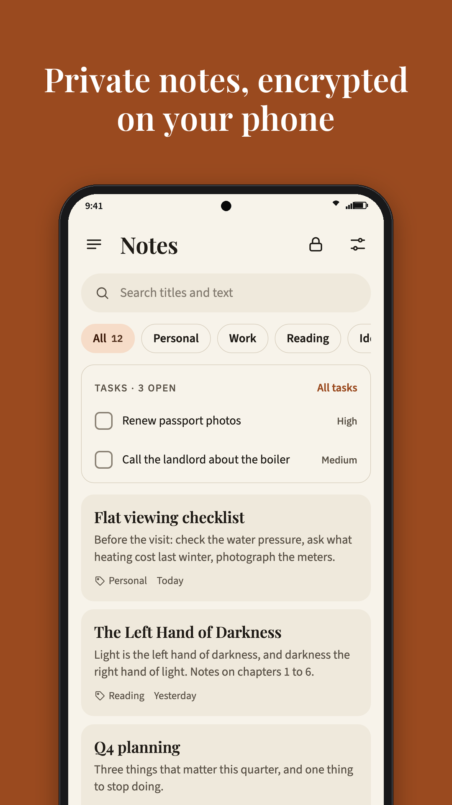
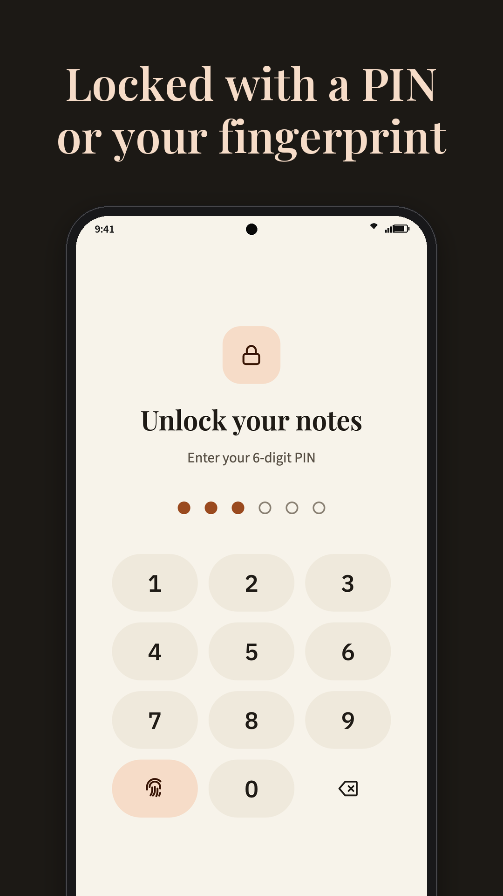
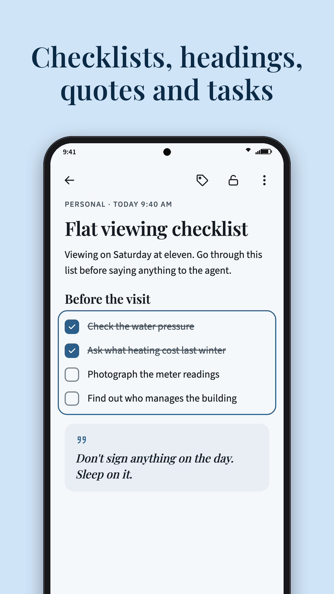
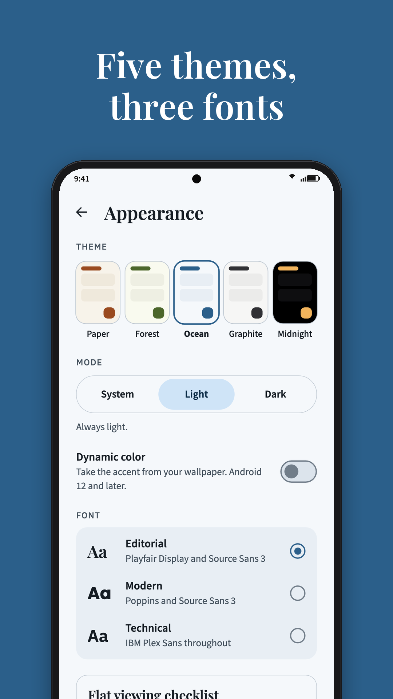

# Encly

[](https://github.com/pasichDev/Encly/actions/workflows/android.yml)
[](https://github.com/pasichDev/Encly/releases/latest)
[](LICENSE)
[](#project-structure)
[](https://hosted.weblate.org/engage/encly/)

**Offline encrypted notes and tasks for Android.**

Encly keeps notes and tasks encrypted on-device. There is no account, sync, telemetry,
notification pipeline, share sheet, or network access. Access is protected by a mandatory app
PIN and, optionally, strong biometrics. The only ways data leaves the phone are an encrypted
backup and, only when you ask for it, a readable Markdown export that is not encrypted.

[](https://ko-fi.com/pasichdev)

## Screenshots

<p>
  
  
  
  
</p>

All eight, with captions in every store language, are in
[`fastlane/metadata/android`](fastlane/metadata/android) (`<locale>/images/phoneScreenshots`).

## Platforms

[](#install)
[](https://github.com/pasichDev/Encly/issues/85)
[](https://github.com/pasichDev/Encly/issues/106)
[](https://github.com/pasichDev/Encly/issues/106)
[](https://github.com/pasichDev/Encly/issues/107)

| Platform | Status | Where |
|---|---|---|
| **Android** 8.0+ (API 26) | released | [Google Play](https://play.google.com/store/apps/details?id=com.pasich.encly), [F-Droid](https://f-droid.org/packages/com.pasich.encly/), [GitHub Releases](https://github.com/pasichDev/Encly/releases/latest) |
| **Linux** (x86-64) | in development | builds in CI, not published ([#85](https://github.com/pasichDev/Encly/issues/85)) |
| **Windows** | in development | builds in CI, not published ([#106](https://github.com/pasichDev/Encly/issues/106)) |
| **macOS** | in development | builds in CI, not published ([#106](https://github.com/pasichDev/Encly/issues/106)) |
| **iOS** | in development | not published ([#107](https://github.com/pasichDev/Encly/issues/107)) |

Every platform has its own vault; nothing syncs between them. An encrypted backup made on one
restores on another with the recovery phrase.

## 💛 Support Encly

Encly is free and open source, with no ads, no tracking and no accounts; donations are its only
income. They go to test devices and to time for releases and fixes.

[](https://ko-fi.com/pasichdev)

Card or PayPal, one-off or monthly. The `fdroid` build shows the same link on its Support screen;
the `play` build has no in-app donation link, by Google Play policy.

## Features

- 🔒 **Encrypted at rest** — Room on SQLCipher with a random 256-bit database key.
- 🔐 **Mandatory lock** — a PIN of 6 to 12 digits bound to the phone's Android Keystore, plus optional
  Class 3 biometric unlock.
- ⏱️ **Auto-lock** — the database closes and its key is wiped after you leave the app
  (immediately up to 30 minutes, 15 s by default) and at once when the screen turns off.
- 🔑 **Optional BIP39 recovery phrase** — 12 words that unlock the vault if you forget the PIN.
- 💾 **Encrypted backups** — one file, sealed with the recovery phrase, saved wherever you choose.
- 📝 **Markdown export** — one note as `.md`, or everything as a `.zip`, after a warning that the
  file is not encrypted and a PIN check. Saved through the system save dialog, never shared.
- 📌 **Organize** — pin, archive and colour notes, with configurable swipe actions on the cards.
- 🚨 **Wipe PIN and duress PIN** — optional PINs that erase the vault or open a decoy one, for
  when you are forced to unlock.
- 🧩 **Block editor** — text, headings, quotes, checklists, nested lists, tables, code blocks,
  links, separators; select across blocks, find in note, and a toolbar you arrange yourself.
- 🏷️ **Tags & tasks** — local organization: several tags per note, tasks with priorities and
  sub-tasks.
- 📥 **Import** — bring notes from Google Keep, Standard Notes, Joplin, Notesnook or Markdown
  files, all offline.
- 🗑️ **Trash** — soft-delete with restore; notes are deleted for good after 28 days.
- 🎨 **5 themes** — Paper, Forest, Ocean, Graphite and Midnight; light, dark or system mode and
  three bundled font sets.
- 📴 **Fully offline** — no `INTERNET` permission, cloud sync, analytics or downloadable fonts
  (editor fonts are bundled). The only links out (privacy policy, issue tracker, email, the
  open-source license pages, a note's link block and, in the `play` flavor, the store page or, in
  the `fdroid` flavor, the Ko-fi donation page) open in another app and only when you tap them.
- 🛡️ **Protected UI** — `FLAG_SECURE` is on from the first Activity frame; screenshots can be allowed
  only until the next lock, after the PIN or a biometric.
- 🌍 **10 languages** — pick one in Settings → Language, independently of the system language;
  Arabic is laid out right to left.

## Languages

English (default), Українська, العربية, Deutsch, Français, Español, Italiano, Polski, Português and
Nederlands.

Encly follows the device language when it is one of these, and falls back to English otherwise.
To use a different language for Encly only, open **Settings → Language** and pick it, or pick
**System default** to follow the device again. The choice applies immediately; on Android 13+
it also appears in the system's per-app language settings.

Translations are done on [Hosted Weblate](https://hosted.weblate.org/projects/encly/), which
offers free hosting to open-source projects. Found a wrong or clumsy translation, or want to add
a language? Fix it there, no Git needed. A pull request that edits the `values-<lang>/` files of `core/resources/src/commonMain/strings`
still works as a fallback: see [CONTRIBUTING.md → Translations](CONTRIBUTING.md#translations).
Many thanks to [Weblate](https://weblate.org) for hosting Encly's translations as libre software.

[](https://hosted.weblate.org/engage/encly/)

## Install

[](https://github.com/pasichDev/Encly/releases/latest)
&nbsp;[](https://play.google.com/store/apps/details?id=com.pasich.encly)
&nbsp;[](https://f-droid.org/packages/com.pasich.encly/)

| Channel | Status | What you get |
|---|---|---|
| **GitHub Releases** | available | `Encly-<version>-fdroid.apk` (no Google Play links) or `Encly-<version>-play.apk` from [Releases](https://github.com/pasichDev/Encly/releases); verify it (below) before installing. |
| **Obtainium** | available | Add `https://github.com/pasichDev/Encly` as the source and filter APKs with `fdroid` to get updates straight from GitHub Releases. |
| **Google Play** | available | The `play` flavor from [Google Play](https://play.google.com/store/apps/details?id=com.pasich.encly). |
| **F-Droid** | available | The `fdroid` flavor from [F-Droid](https://f-droid.org/packages/com.pasich.encly/), built by F-Droid from source and shipped with the developer signature (reproducible build), so it updates the GitHub APK and back. |

All channels use the same application ID and are meant to be signed with the same certificate,
so one can update another. If Android refuses such an update, do **not** uninstall without an
exported backup: uninstalling deletes the vault.

Requires Android 8.0 (API 26) or newer. Google Play Services are not needed.

Android is the only platform Encly is released for. The repository also holds a desktop app
(Linux, Windows, macOS) and an iOS app; they build, but they are **not published and not
supported yet** ([#85](https://github.com/pasichDev/Encly/issues/85),
[#106](https://github.com/pasichDev/Encly/issues/106),
[#107](https://github.com/pasichDev/Encly/issues/107)).

## Verify a release

Every release ships a `SHA256SUMS` file (and `SHA256SUMS.asc` when it is GPG-signed).

```bash
sha256sum -c --ignore-missing SHA256SUMS          # APK matches the published checksum
apksigner verify --print-certs Encly-3.0.0-fdroid.apk
```

`apksigner` (Android SDK build-tools) must print this release signing certificate SHA-256
digest:

```text
6884c693354964276231e6d0336b965f690bf3f15a0707bb59505c208e5e7554
```

Any other certificate means the APK is not an official Encly build.

The release workflow refuses to publish an APK that is not signed with this certificate.

## Upgrading

- **From 2.x:** update in place. The vault format is v3, as it has been since 2.0, and 3.0
  does not change it: your PIN, biometrics, recovery phrase, notes and backups carry over.
  There is no way back to 2.x after upgrading: Android refuses to install an older version over
  a newer one, and uninstalling deletes the vault.
- **From 1.x:** 1.x data is not migrated (a different storage format). 1.x never had public
  users; if you ran it yourself, uninstall it before installing 3.0.

## Security model

Encly uses envelope encryption (vault format v3, unchanged since 2.0) rather than deriving the
SQLCipher key directly from a seed or PIN:

1. Onboarding creates a random 256-bit **DEK** (data-encryption key).
2. SQLCipher is opened with that DEK.
3. The mandatory PIN is processed with **PBKDF2-HMAC-SHA256 (600k)** and a random salt,
   and mixed (HKDF) with an HMAC from a non-exportable **Android Keystore** key (StrongBox
   when the phone has one), so PIN guesses can only run on this device. The resulting KEK
   wraps the DEK using **AES-256-GCM**. Encly does not store a PIN hash.
4. If biometrics are enabled, the same DEK gets a second AES-GCM slot protected by an
   auth-per-use AndroidKeyStore key. Unwrapping requires
   `BiometricPrompt.CryptoObject` with `BIOMETRIC_STRONG`.
5. With a recovery phrase (offered during setup, or later in Settings → Security), a 12-word
   BIP39 seed derives a recovery KEK and wraps the same DEK in a separate AES-GCM recovery
   slot. The same words are the only key to encrypted backups.
6. After Encly leaves the screen (after the auto-lock delay in Settings → Security, 15 s by
   default, or at once when the screen turns off), SQLCipher is closed and Encly's in-memory
   DEK copy is zeroized. The next entry must unwrap the DEK again.

Skipping the recovery phrase leaves the vault with **no recovery seed** and no backups.
Losing the PIN in that case makes the encrypted database unrecoverable.

**Erase all data** (Settings → Security, in the danger zone: hold the button for 5 s, confirm,
then enter the PIN or use the fingerprint) deletes the database, every key slot and Encly's
Keystore keys, and starts setup again.

The app also disables Android backup/device transfer for protected data and has no
system notifications, a share sheet, calendar export, or seed export; the only thing it copies
to the clipboard by itself is a link block's address, on request and marked sensitive. Data
leaves the phone in two ways, both started by you. An **encrypted backup** (Settings → Backup)
is sealed with your 12-word recovery phrase, and the same words restore it on a new phone
("Restore from backup" in onboarding). A **Markdown export** (a note's menu, or Settings →
Backup) is readable by anyone who has the file: Encly warns you first, asks for your PIN (or
biometrics) again, and writes only to the document you create in the system save dialog.

See [SECURITY.md](SECURITY.md) for the threat model and reporting process, and the
[privacy policy](https://pasichdev.xyz/apps/encly/privacy-policy/) (also in
[PRIVACY.md](PRIVACY.md)).

## Tech stack

Kotlin Multiplatform · Compose Multiplatform · Material 3 · Metro · Room (KMP) · SQLCipher
through the Sealite driver · Coroutines · kotlinx.serialization · BIP39 (own implementation)

Clean architecture: `presentation` → `domain` → `data`, with `core/security`
coordinating the key vault.

## Project structure

Encly 3.0 is a Kotlin Multiplatform codebase: nearly everything is shared, and each platform
is a thin host around it. Details in [docs/architecture.md](docs/architecture.md).

| Module | What it is |
|---|---|
| `app` | The Android app and its release flavors (`fdroid`, `play`): `MainActivity`, the Metro graph, Keystore and biometric adapters. |
| `shared` | Domain, data, screens, navigation and ViewModels, in common code; the desktop and iOS hosts' parts live here too. |
| `editor` | The block editor, independent of the app. |
| `core:common`, `core:crypto`, `core:security` | Shared helpers; AES-GCM, HKDF, PBKDF2 and BIP39; the vault, the unlock-secret policy and its PIN and passphrase slots, lockout, auto-lock and the backup format. |
| `core:database` | Room and the encrypted database (SQLCipher through Sealite), with the exported schemas. |
| `core:keystore` | The desktop's OS secret store for the vault's device key, and the desktop's unlock secret (a passphrase stretched with Argon2id). |
| `core:resources` | Every user-visible string (`src/commonMain/strings/values*/`) and the translations. |
| `desktopApp`, `iosApp` | The desktop (Windows, macOS, Linux) and iOS hosts. Not released. |
| `build-logic` | Gradle convention plugins. |

## Build

Requirements:

- **JDK 21** (Android Studio's bundled JBR works).
- **Android SDK** with `platforms;android-36` and `build-tools;36.0.0` (AGP installs missing
  build-tools on first build if the SDK directory is writable).

Tell Gradle where the SDK is, either through the environment:

```bash
export ANDROID_HOME="$HOME/Library/Android/sdk"     # macOS default
# export ANDROID_HOME="$HOME/Android/Sdk"           # Linux default
```

or through an untracked `local.properties` at the repo root (Android Studio writes it for you):

```bash
echo "sdk.dir=$HOME/Library/Android/sdk" > local.properties
```

Without one of these the build stops with `SDK location not found`. To install the packages
from the command line: `sdkmanager "platforms;android-36" "build-tools;36.0.0"`.

The app has two distribution flavors with the same application ID: `fdroid` (no Google Play
links, no baseline profile) and `play`.

```bash
./gradlew :app:assembleFdroidDebug                 # debug APK (com.pasich.encly.debug)
./gradlew :app:assemblePlayDebug                   # the same, play flavor
./gradlew :app:testFdroidDebugUnitTest             # JVM unit tests
./gradlew :app:koverVerifyFdroidDebug              # coverage gate (the Android app: activities and adapters, 85%)
./gradlew :shared:desktopTest :shared:testAndroidHostTest :shared:koverVerify   # the UI and data logic (85%)
./gradlew :editor:desktopTest :editor:testAndroidHostTest :editor:koverVerify   # the editor module (100%)
./gradlew :app:detekt :app:lintFdroidRelease       # static analysis
./gradlew spotlessApply                            # format Kotlin/Gradle (ktlint; spotlessCheck in CI)
./gradlew assembleRelease                          # both release APKs, R8 enabled
./gradlew :app:bundlePlayRelease                   # Google Play App Bundle (play flavor)
./gradlew :core:database:desktopTest :core:database:testAndroidHostTest :core:database:koverVerify   # the database module (85%)
./gradlew :core:database:connectedAndroidDeviceTest   # instrumented tests (emulator): native SQLCipher, migrations
```

Outputs: `app/build/outputs/apk/<flavor>/<buildType>/`, and the bundle in
`app/build/outputs/bundle/playRelease/`. Releasing: [CONTRIBUTING.md → Releasing](CONTRIBUTING.md#releasing).

The desktop and iOS targets build too, but only Android is released: `./gradlew :desktopApp:run`
starts the desktop app ([desktopApp/README.md](desktopApp/README.md)), and the iOS app is built
from Xcode on a Mac ([iosApp/README.md](iosApp/README.md)).

### Release signing for local builds (optional)

Local release builds are unsigned unless all four signing values are provided, either as
environment variables:

```bash
export ENCLY_KEYSTORE_PATH=/path/to/release.jks
export ENCLY_KEYSTORE_PASSWORD=…
export ENCLY_KEY_ALIAS=…
export ENCLY_KEY_PASSWORD=…
```

or in an untracked `keystore.properties` at the repo root (environment variables win):

```
storeFile=/path/to/keystore.jks
storePassword=…
keyAlias=…
keyPassword=…
```

Keystores and `keystore.properties` are git-ignored; never commit them.

CI does not use these: the release workflows build unsigned and sign the APKs and the bundle
with `apksigner` / `jarsigner` in a separate step, so Gradle never sees the keystore.

### Versioning and releases

`version.properties` is the single source of the version: `versionName = MAJOR.MINOR.PATCH`,
`versionCode = MAJOR*10000 + MINOR*100 + PATCH`. Pushing a tag `vMAJOR.MINOR.PATCH` that matches
it runs [`release.yml`](.github/workflows/release.yml), which builds, signs, checks the signing
certificate, and publishes the APKs, `SHA256SUMS` and R8 mapping files as a GitHub Release. The
run fails, rather than publishing unsigned APKs, when the signing secrets are missing.
See [CONTRIBUTING.md](CONTRIBUTING.md#releasing).

## Documentation

- [Privacy policy](https://pasichdev.xyz/apps/encly/privacy-policy/) ([PRIVACY.md](PRIVACY.md))
- [Security model](SECURITY.md)
- [Changelog](CHANGELOG.md)
- [Architecture](docs/architecture.md)
- [iOS app](iosApp/README.md) (not released yet)
- [Desktop app](desktopApp/README.md) (Windows, macOS, Linux: run, package, data location, security notes; not released yet)

## Contributing

Issues and PRs are welcome — see [CONTRIBUTING.md](CONTRIBUTING.md) and the
[Code of Conduct](CODE_OF_CONDUCT.md). Report vulnerabilities privately as described in
[SECURITY.md](SECURITY.md#reporting-a-vulnerability), not in public issues.

## License

[Apache License 2.0](LICENSE). Bundled fonts are under the SIL Open Font License 1.1; see
[`licenses/fonts`](licenses/fonts).
